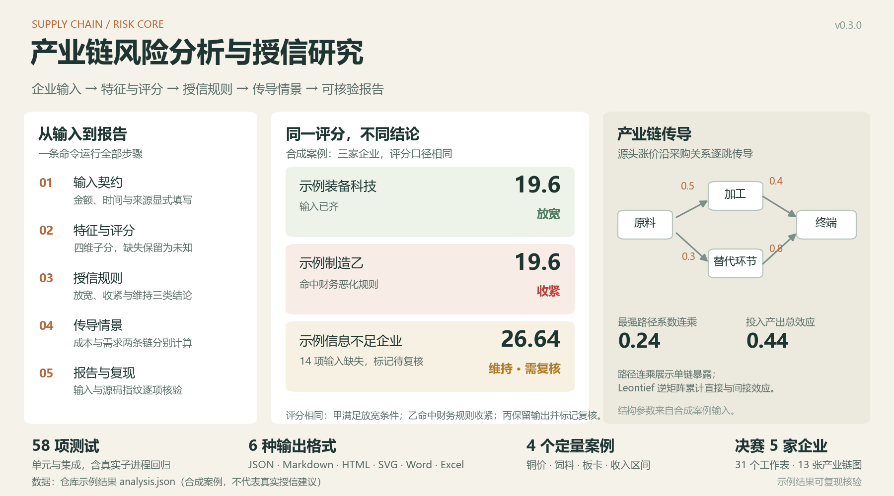
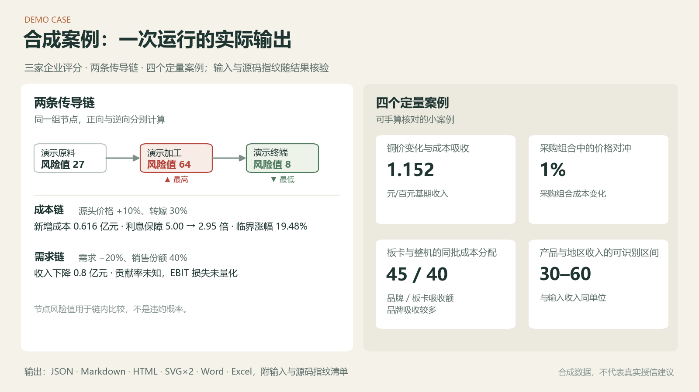
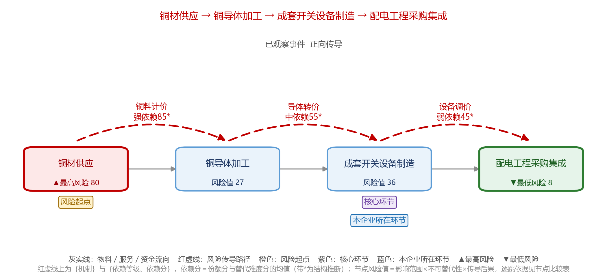

# Supply Chain Risk Analysis and Credit Research

[简体中文](README.md) · **English** · [Español](README.es.md) · [日本語](README.ja.md)

**First place in both rounds of the Guangzhou ICBC Cup challenge at the 5th Pazhou Algorithm Competition.**

| Round | Rank | Competition score | Teams listed |
| --- | ---: | ---: | ---: |
| Preliminary | **1st** | **67.2** | 53 |
| Final | **1st** | **74.04** | 15 |

These ranks apply to this challenge only. The scores are competition scores, not measures of predictive accuracy. The archived competition-platform leaderboards were checked on November 13, 2026; the [results summary](docs/competition-results.json) records their hashes and the source cells.

This is the public edition of an individual competition entry. The project uses public data to recommend whether to tighten, maintain or ease credit terms for 25 companies and to suggest risk controls. It also studies transmission paths, dependencies and scenario amounts across 13 supply chains involving five companies. This repository includes runnable code, synthetic examples and the author's final-round deliverables: **five Excel workbooks, 31 worksheets, 13 supply chain diagrams and a Word document explaining the models**.

[Competition and results](docs/competition.md) · [Competition retrospective](docs/competition-journey.md) · [Final-round deliverables](case-studies/finals/README.md) · [Demo report](examples/results/report.md) · [Methods](docs/method.md)



## What the project covers

| Area | Entry point | Outputs |
| --- | --- | --- |
| Business registration and financial features | [credit/workflow.py](src/supply_chain_risk_core/credit/workflow.py) | Capital, years in operation, operating and solvency features, and an explicit list of missing inputs |
| Scoring and credit rules | [credit/scoring.py](src/supply_chain_risk_core/credit/scoring.py), [credit/decision.py](src/supply_chain_risk_core/credit/decision.py) | Scores across four dimensions, credit direction, triggered rules and the rationale for risk controls |
| Paths and company facts | [supply_chain.py](src/supply_chain_risk_core/supply_chain.py), [facts.py](src/supply_chain_risk_core/facts.py) | Strongest-path exposure and traceable direct guarantees and receivables relationships |
| Input-output analysis and scenarios | [input_output.py](src/supply_chain_risk_core/input_output.py), [scenarios.py](src/supply_chain_risk_core/scenarios.py) | Total input requirements, price effects with the source price held fixed, and cost and demand stress scenarios |
| Stage 2 analysis | [stage2](src/supply_chain_risk_core/stage2/) | Node comparison, dependency strength, cost allocation and bounds on revenue for a given product and region |
| Reporting and reproducibility | [reporting.py](src/supply_chain_risk_core/reporting.py), [cli.py](src/supply_chain_risk_core/cli.py) | JSON, Markdown, HTML, SVG, Word, Excel, and input and source-code hashes |

## Run the full demo

Use Python 3.10 or later. From the repository root in Windows PowerShell:

```powershell
python -m venv .venv
.\.venv\Scripts\python.exe -m pip install ".[reports]"
.\.venv\Scripts\python.exe -m supply_chain_risk_core.cli demo --output output\demo-01
.\.venv\Scripts\python.exe -m supply_chain_risk_core.cli verify output\demo-01
```

On macOS or Linux, use `.venv/bin/python` and `output/demo-01`. Use a new output directory; existing results are not overwritten.

Open `report.html`, `report.docx` or `report.xlsx` in the output directory. The demo runs without fetching data online or accessing the competition files. For text and vector outputs only, install with `pip install .` and add `--without-office` to the demo command.

In the synthetic demo, companies A and B both have a four-dimension risk score of 19.6. A qualifies for eased terms, while B is subject to tighter terms under a rule for deteriorating finances. Company C is missing several inputs, so the model result is retained and flagged for review. The example shows how the financial evidence and scoring layers contribute to the result; it gives no credit recommendation for real companies.



## Use your own input

```powershell
.\.venv\Scripts\python.exe -m supply_chain_risk_core.cli example --output my-input.json
.\.venv\Scripts\python.exe -m supply_chain_risk_core.cli run --input my-input.json --output output\my-run-01
```

See the [input contract](docs/input-schema.md) for the format. Specify monetary units, dates, sources and unknowns explicitly. Capital amounts use a common syntax for unit conversion, and net profits over three periods must agree with the number of loss years. The [0.3.1 validation record](docs/input-integrity-validation.md) describes the boundaries and regression checks. The input's `sources` includes content and hashes. The program checks consistency and applicable dates; a URL alone is not evidence of online verification.

All three options are recorded in the result manifest:

- `--no-review-on-missing`: disables the review flag triggered by missing inputs while retaining the missing items and evidence status.
- `--include-policy-prior`: includes the original model's historical sector-policy prior, which is off by default.
- `--advice-policy exact_match`: selects the historical recommendation policy; the default `business_complete` policy provides broader research-oriented measures.

## Browse the final-round deliverables

The [final-round case index](case-studies/finals/README.md) includes analysis workbooks for company IDs 006, 011, 018, 023 and 025, as well as all 13 figures. These files come from the reviewed October 11, 2026 edition and match the author's retained deliverables.



The [model explanation](case-studies/finals/model-explanation.docx) describes the problem, evidence definitions, methods and limits. The [case manifest](case-studies/finals/source-manifest.json) provides the SHA-256 hash of each file. The static deliverables and the editable synthetic demo have separate provenance records.

## Methodological limits

- Strongest-path exposure is the maximum product of edge weights along a path. The Leontief total effect accumulates direct and indirect input requirements. In the example, these are **0.24** and **0.44**, respectively.
- A fall in revenue under a demand shock does not directly give a fall in profit. If the contribution margin is unknown, both EBIT loss and post-shock interest coverage remain unknown.
- Node risk and dependency scores support comparison and interpretation; they are not probabilities of default.
- The original model lacks independent ground-truth validation sufficient to establish competitive predictive performance. Tests, reproducibility checks and historical contest feedback address different questions.
- This repository contains the general workflow and selected deliverables. It does not distribute the original contest data, original company annual reports, account records or restricted evaluation data package. Reproducing the full historical scored submission requires the corresponding inputs and permission to use them.

See [methods](docs/method.md), [lessons from the project](docs/lessons.md) and [provenance and publication scope](docs/provenance.md).

## Verification and development

```powershell
.\.venv\Scripts\python.exe -m pip install ".[reports,dev]"
.\.venv\Scripts\python.exe -m unittest discover -s tests -v
.\.venv\Scripts\python.exe -m ruff check src tests tools
.\.venv\Scripts\python.exe tools\check_manifest.py
.\.venv\Scripts\python.exe -m build
```

The [validation record](docs/expansion-validation.md) covers unit tests, comparisons with the original algorithms, package installation, report rendering and actual CLI reproduction. See the [API contract](docs/api.md) for the original standalone core's interfaces and compatibility options.

Code is provided under the [MIT License](LICENSE). Cited materials retain their source rights and terms of use. The included analyses are the author's own work, and synthetic cases are marked as such.
