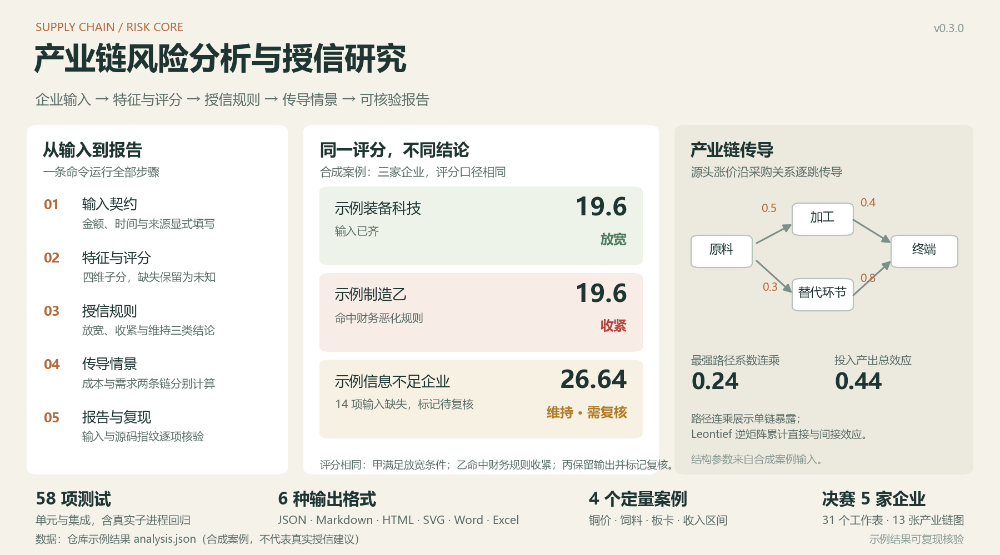
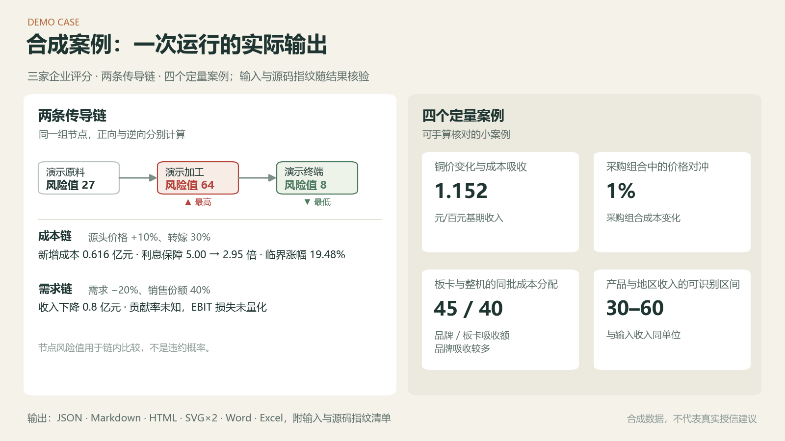
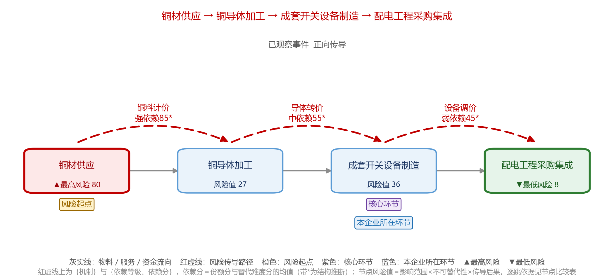

# Análisis de riesgos en cadenas de suministro y estudio del crédito

[简体中文](README.md) · [English](README.en.md) · **Español** · [日本語](README.ja.md)

**Primer puesto en las dos rondas del reto Copa ICBC de Guangzhou, en la quinta edición del Concurso de Algoritmos de Pazhou.**

| Ronda | Puesto | Puntuación | Equipos en la clasificación |
| --- | ---: | ---: | ---: |
| Preliminar | **1.º** | **67,2** | 53 |
| Final | **1.º** | **74,04** | 15 |

Los puestos corresponden solo a este reto. Los puntos reflejan la evaluación del concurso, no la precisión predictiva. Las clasificaciones archivadas de la plataforma se cotejaron el 13 de noviembre de 2026; el [resumen de resultados](docs/competition-results.json) registra las sumas de verificación y las celdas de origen.

Esta es la edición pública de un trabajo individual para el concurso. El proyecto usa datos públicos para proponer orientaciones de crédito y medidas de control del riesgo para 25 empresas. También estudia las vías de propagación, las dependencias y los importes bajo distintos escenarios en 13 cadenas de suministro de cinco empresas. Incluye código ejecutable, casos sintéticos y entregables de la final elaborados por el autor: **cinco libros de Excel, 31 hojas, 13 diagramas de cadenas de suministro y un documento de Word que explica los modelos**.

[Concurso y resultados](docs/competition.md) · [Balance de la participación](docs/competition-journey.md) · [Entregables de la final](case-studies/finals/README.md) · [Informe de demostración](examples/results/report.md) · [Métodos](docs/method.md)



## Qué incluye el proyecto

| Área | Punto de entrada | Resultados |
| --- | --- | --- |
| Datos registrales y financieros | [credit/workflow.py](src/supply_chain_risk_core/credit/workflow.py) | Capital, antigüedad, variables operativas y de solvencia, y una lista explícita de datos faltantes |
| Puntuación y reglas de crédito | [credit/scoring.py](src/supply_chain_risk_core/credit/scoring.py), [credit/decision.py](src/supply_chain_risk_core/credit/decision.py) | Puntuaciones en cuatro dimensiones, orientación de crédito, reglas activadas y fundamentos de las medidas de control |
| Rutas y hechos empresariales | [supply_chain.py](src/supply_chain_risk_core/supply_chain.py), [facts.py](src/supply_chain_risk_core/facts.py) | Exposición de la ruta más fuerte y relaciones directas y trazables de garantías y cuentas por cobrar |
| Análisis insumo-producto y escenarios | [input_output.py](src/supply_chain_risk_core/input_output.py), [scenarios.py](src/supply_chain_risk_core/scenarios.py) | Requerimientos totales de insumos, efectos sobre los precios con el precio de origen fijo y escenarios de presión en costes y demanda |
| Análisis de la segunda etapa | [stage2](src/supply_chain_risk_core/stage2/) | Comparación de nodos, intensidad de dependencias, reparto de costes y límites de ingresos para un producto y una región determinados |
| Informes y reproducibilidad | [reporting.py](src/supply_chain_risk_core/reporting.py), [cli.py](src/supply_chain_risk_core/cli.py) | JSON, Markdown, HTML, SVG, Word, Excel y sumas de verificación de entradas y código fuente |

## Ejecutar el caso completo

Usa Python 3.10 o posterior. En Windows, ejecuta estos comandos en PowerShell desde la raíz del repositorio:

```powershell
python -m venv .venv
.\.venv\Scripts\python.exe -m pip install ".[reports]"
.\.venv\Scripts\python.exe -m supply_chain_risk_core.cli demo --output output\demo-01
.\.venv\Scripts\python.exe -m supply_chain_risk_core.cli verify output\demo-01
```

En macOS o Linux, usa `.venv/bin/python` y `output/demo-01`. El directorio de salida debe ser nuevo; no se sobrescriben resultados existentes.

Abre `report.html`, `report.docx` o `report.xlsx` en el directorio de salida. El ejemplo no requiere obtener datos de Internet ni acceder a los archivos del concurso. Para generar solo texto y gráficos vectoriales, instala con `pip install .` y añade `--without-office` al comando de demostración.

En el caso sintético, las empresas A y B tienen la misma puntuación de riesgo en cuatro dimensiones: 19,6. A cumple las condiciones para flexibilizar el crédito; B queda sujeta a condiciones más estrictas por una regla de deterioro financiero. Para la empresa C faltan varios datos, por lo que se conserva el resultado y se marca para revisión. El ejemplo distingue el papel de la evidencia financiera y el de la puntuación; no da recomendaciones para empresas reales.



## Usar datos propios

```powershell
.\.venv\Scripts\python.exe -m supply_chain_risk_core.cli example --output my-input.json
.\.venv\Scripts\python.exe -m supply_chain_risk_core.cli run --input my-input.json --output output\my-run-01
```

Consulta el [contrato de entrada](docs/input-schema.md). Indica explícitamente unidades monetarias, fechas, fuentes y datos desconocidos. Los importes de capital siguen una sintaxis común para convertir unidades, y el beneficio neto de tres periodos debe concordar con el número de años con pérdidas. El [registro de validación de la versión 0.3.1](docs/input-integrity-validation.md) detalla los límites y las pruebas de regresión. El campo `sources` incluye contenido y sumas de verificación. El programa comprueba la coherencia y las fechas aplicables; una URL por sí sola no equivale a verificación en línea.

Las tres opciones quedan registradas en el manifiesto de resultados:

- `--no-review-on-missing`: desactiva la marca de revisión por datos faltantes, pero conserva esos datos como desconocidos y mantiene el estado de la evidencia.
- `--include-policy-prior`: incorpora el supuesto previo histórico sobre políticas sectoriales del modelo original; está desactivado por defecto.
- `--advice-policy exact_match`: selecciona la política histórica de recomendaciones; por defecto, `business_complete` ofrece medidas más amplias con fines de investigación.

## Consultar los entregables de la final

El [índice de casos de la final](case-studies/finals/README.md) contiene los libros de análisis de las empresas con ID 006, 011, 018, 023 y 025, además de las 13 figuras. Los archivos proceden de la versión revisada del 11 de octubre de 2026 y coinciden con los entregables conservados por el autor.



La [explicación de los modelos](case-studies/finals/model-explanation.docx) describe el problema, los criterios de evidencia, los métodos y sus límites. El [manifiesto de los casos](case-studies/finals/source-manifest.json) incluye el SHA-256 de cada archivo. Los entregables estáticos y la demostración sintética editable tienen registros de procedencia separados.

## Límites de los métodos

- La exposición de la ruta más fuerte es el máximo producto de los pesos de las aristas a lo largo de una ruta. El efecto total de Leontief acumula los requerimientos directos e indirectos. En el ejemplo, estos valores son **0,24** y **0,44**, respectivamente.
- Una reducción de los ingresos por un choque de demanda no se traduce directamente en una caída del beneficio. Si se desconoce el margen de contribución, también quedan sin determinar la pérdida de EBIT y la cobertura de intereses posterior al choque.
- Las puntuaciones de riesgo de los nodos y las de dependencia sirven para comparar e interpretar; no son probabilidades de impago.
- El modelo original carece de una validación independiente con datos de referencia suficiente para demostrar un rendimiento predictivo competitivo. Las pruebas, la reproducción de resultados y los comentarios del concurso responden a preguntas distintas.
- El repositorio ofrece el proceso general y entregables seleccionados. No distribuye los datos originales del concurso, los informes anuales originales, datos de cuentas ni el paquete de evaluación de acceso restringido. Reproducir la entrega completa que se puntuó requiere los datos correspondientes y permiso para usarlos.

Consulta los [métodos](docs/method.md), las [lecciones del proyecto](docs/lessons.md) y la [procedencia y alcance de la publicación](docs/provenance.md).

## Verificación y desarrollo

```powershell
.\.venv\Scripts\python.exe -m pip install ".[reports,dev]"
.\.venv\Scripts\python.exe -m unittest discover -s tests -v
.\.venv\Scripts\python.exe -m ruff check src tests tools
.\.venv\Scripts\python.exe tools\check_manifest.py
.\.venv\Scripts\python.exe -m build
```

El [registro de validación](docs/expansion-validation.md) documenta las pruebas unitarias, la comparación con los algoritmos originales, la instalación del paquete, la visualización de informes y la reproducción con la herramienta de línea de comandos. El [contrato de API](docs/api.md) describe las interfaces y opciones de compatibilidad del núcleo independiente original.

El código se publica bajo la [licencia MIT](LICENSE). Los materiales citados conservan los derechos y condiciones de sus fuentes. Se incluyen análisis propios del autor y casos identificados como sintéticos.
