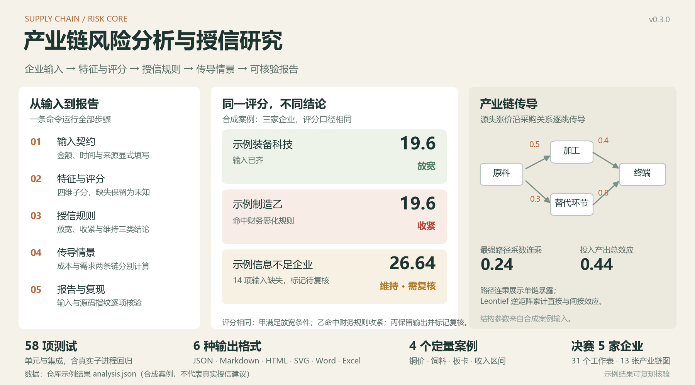
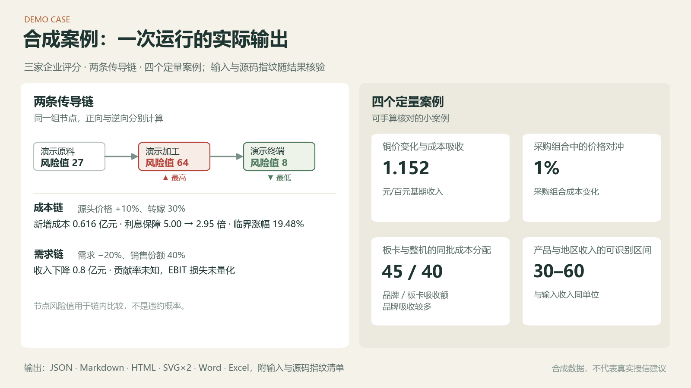
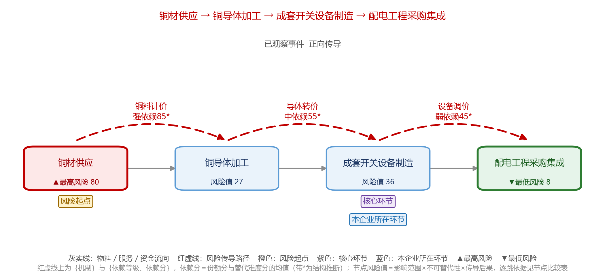

# サプライチェーンのリスク分析と与信研究

[简体中文](README.md) · [English](README.en.md) · [Español](README.es.md) · **日本語**

**第5回琶洲アルゴリズム大会の「広州工商銀行杯」課題で、予選・決勝ともに1位。**

| 段階 | 順位 | 大会スコア | 順位表のチーム数 |
| --- | ---: | ---: | ---: |
| 予選 | **1位** | **67.2** | 53 |
| 決勝 | **1位** | **74.04** | 15 |

順位はこの課題内での順位です。スコアは大会での評価点で、予測精度を表すものではありません。保存された大会プラットフォームの順位表を2026年11月13日に照合しました。元ファイルのハッシュと該当セルは[成績の概要](docs/competition-results.json)に記載しています。

個人で参加した大会のプロジェクトを公開用にまとめたものです。公開データを基に25社の与信方針とリスク対策を検討し、5社に関わる13のサプライチェーンについて、リスクの波及経路、依存度、シナリオ別の金額を分析します。実行可能なコード、合成事例に加え、著者が作成した決勝成果物として **Excel ブック5冊・計31シート、サプライチェーン図13点、モデル解説の Word 文書1点** を収録しています。

[大会と成績](docs/competition.md) · [参加の経緯と振り返り](docs/competition-journey.md) · [決勝成果物](case-studies/finals/README.md) · [デモレポート](examples/results/report.md) · [分析手法](docs/method.md)



## 分析できる内容

| 分野 | 実装 | 出力 |
| --- | --- | --- |
| 企業登記・財務特徴量 | [credit/workflow.py](src/supply_chain_risk_core/credit/workflow.py) | 資本、事業年数、事業運営・支払能力の特徴量と欠損項目一覧 |
| スコアリングと与信ルール | [credit/scoring.py](src/supply_chain_risk_core/credit/scoring.py)、[credit/decision.py](src/supply_chain_risk_core/credit/decision.py) | 4軸のスコア、与信方針、該当ルールと対策の根拠 |
| 波及経路と企業関係の事実 | [supply_chain.py](src/supply_chain_risk_core/supply_chain.py)、[facts.py](src/supply_chain_risk_core/facts.py) | 最強経路のエクスポージャー、根拠を追跡できる直接の保証・売掛金関係 |
| 産業連関とシナリオ | [input_output.py](src/supply_chain_risk_core/input_output.py)、[scenarios.py](src/supply_chain_risk_core/scenarios.py) | 総投入必要量、起点の価格を固定した場合の価格波及、コスト・需要のストレスシナリオ |
| 第2段階の分析 | [stage2](src/supply_chain_risk_core/stage2/) | ノードの比較、依存度、コスト配分、特定の製品と地域の組み合わせにおける売上高の上限・下限 |
| レポートと再現 | [reporting.py](src/supply_chain_risk_core/reporting.py)、[cli.py](src/supply_chain_risk_core/cli.py) | JSON、Markdown、HTML、SVG、Word、Excel と、入力・ソースコードのハッシュ |

## デモを通しで実行する

Python 3.10 以上が必要です。Windows PowerShell でリポジトリのルートから実行します。

```powershell
python -m venv .venv
.\.venv\Scripts\python.exe -m pip install ".[reports]"
.\.venv\Scripts\python.exe -m supply_chain_risk_core.cli demo --output output\demo-01
.\.venv\Scripts\python.exe -m supply_chain_risk_core.cli verify output\demo-01
```

macOS / Linux では `.venv/bin/python` と `output/demo-01` を使用します。まだ存在しない出力ディレクトリを指定してください。既存の結果は上書きしません。

出力先の `report.html`、`report.docx`、`report.xlsx` を開いて結果を確認できます。デモの実行に外部データの取得や大会資料へのアクセスは不要です。テキストとベクター画像だけを生成する場合は、`pip install .` でインストールし、デモのコマンドに `--without-office` を追加します。

合成デモでは、A社とB社の4軸のリスクスコアはともに19.6です。A社は条件緩和の基準を満たしますが、B社は財務悪化ルールにより条件厳格化の対象となります。C社は複数の資料が不足しているため、モデルの出力を保持したうえで要確認とします。財務上の根拠とスコアリングの役割を示す例であり、実在の企業に対する与信提案ではありません。



## 独自の入力を使う

```powershell
.\.venv\Scripts\python.exe -m supply_chain_risk_core.cli example --output my-input.json
.\.venv\Scripts\python.exe -m supply_chain_risk_core.cli run --input my-input.json --output output\my-run-01
```

形式は[入力仕様](docs/input-schema.md)を参照してください。金額単位、日付、出典、不明項目を明示します。資本の記述には統一した書式を使い、3期分の純利益と赤字年数を一致させます。[0.3.1 の検証記録](docs/input-integrity-validation.md)に入力境界と回帰テストを記載しています。入力の `sources` には内容とハッシュを含めます。プログラムは整合性と適用日を確認します。URL の記載だけでは、オンラインで確認済みの根拠にはなりません。

次の3つのオプションは結果のマニフェストに記録されます。

- `--no-review-on-missing`：欠損に起因する要確認のフラグを無効にします。欠損項目とモデルの根拠の状態は保持します。
- `--include-policy-prior`：元モデルの過去の業種別政策に基づく事前情報を使用します。既定では無効です。
- `--advice-policy exact_match`：大会当時の対策提案ルールを選びます。既定の `business_complete` は研究用に幅広い対策を示します。

## 決勝の成果物を見る

[決勝事例の一覧](case-studies/finals/README.md)には、企業ID 006、011、018、023、025 の分析ブックと全13図があります。2026年10月11日の最終確認版に基づき、著者が保存している成果物と一致します。



[モデル解説](case-studies/finals/model-explanation.docx)には、対象の課題、根拠の取り扱い、計算手法、適用範囲をまとめています。[事例のファイル一覧](case-studies/finals/source-manifest.json)には各ファイルの SHA-256 を記載しています。固定された決勝成果物と編集可能な合成デモは、出典を別々に記録しています。

## 手法の適用範囲

- 最強経路のエクスポージャーは、各経路に沿った辺の重みの積の最大値です。レオンチェフの総効果は直接・間接の投入必要量を合算します。例ではそれぞれ **0.24** と **0.44** です。
- 需要ショックによる売上高の減少を、そのまま利益の減少とは見なしません。限界利益率が不明な場合、EBIT の損失とショック後の利息カバレッジも不明のままです。
- ノードのリスクスコアと依存度は比較・解釈の指標であり、デフォルト確率ではありません。
- 元モデルについて、予測性能の競争力を示せるだけの独立した正解データによる検証は行われていません。テスト、再現性の確認、大会での評価はそれぞれ目的が異なります。
- 公開範囲は汎用の分析手順と一部の成果物です。大会の元データ、企業年次報告書の原本、アカウント情報、利用許可が必要な審査用データ一式は配布していません。採点対象となった当時の提出物を完全に再現するには、対応する入力と利用権限が必要です。

[分析手法](docs/method.md)、[プロジェクトで得た知見](docs/lessons.md)、[出典と公開範囲](docs/provenance.md)を参照してください。

## 検証と開発

```powershell
.\.venv\Scripts\python.exe -m pip install ".[reports,dev]"
.\.venv\Scripts\python.exe -m unittest discover -s tests -v
.\.venv\Scripts\python.exe -m ruff check src tests tools
.\.venv\Scripts\python.exe tools\check_manifest.py
.\.venv\Scripts\python.exe -m build
```

[検証記録](docs/expansion-validation.md)には、単体テスト、元のアルゴリズムとの比較、パッケージのインストール、レポート表示、CLI を実行した再現確認の範囲を記載しています。元の独立コアのインターフェースと互換オプションについては [API 仕様](docs/api.md)を参照してください。

コードは [MIT License](LICENSE) で提供します。引用資料には出典ごとの権利と利用条件が適用されます。収録する分析成果物は著者が作成したものです。合成事例にはその旨を明記しています。
