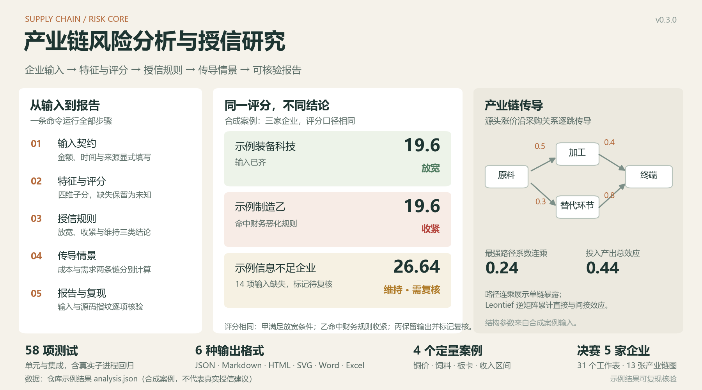
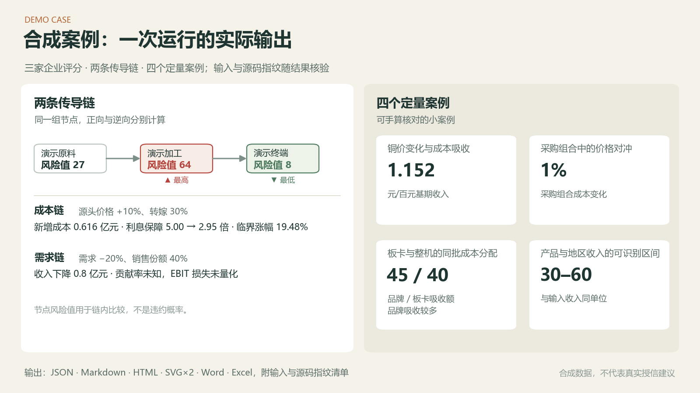
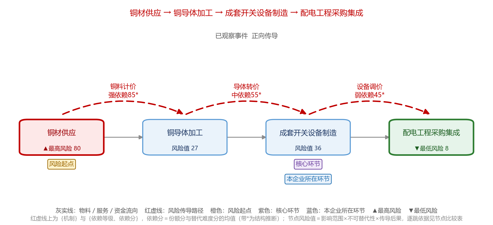

# 产业链风险分析与授信研究

工行杯个人参赛工程的公开整理版。输入工商、财务和来源记录，运行特征工程、评分与授信规则，再计算产业链传导情景，生成可以重新计算核验的分析报告。

仓库同时保留了本人编制的决赛分析成品：**五本 Excel、31 个工作表、13 张产业链图和一份模型讲解 Word**。通用代码使用合成案例演示；实际参赛报告按原版本单独归档。

[查看完整演示结果](examples/results/report.md) · [查看决赛成果](case-studies/finals/README.md) · [方法与边界](docs/method.md) · [输入格式](docs/input-schema.md)

## 已收录的能力

| 部分 | 入口 | 输出 |
| --- | --- | --- |
| 工商与财务特征 | [credit/workflow.py](src/supply_chain_risk_core/credit/workflow.py) | 资本、年限、经营与偿付能力特征，明确的缺失清单 |
| 评分与授信规则 | [credit/scoring.py](src/supply_chain_risk_core/credit/scoring.py)、[credit/decision.py](src/supply_chain_risk_core/credit/decision.py) | 四维子分、授信方向、规则命中和风控建议依据 |
| 路径与企业事实 | [supply_chain.py](src/supply_chain_risk_core/supply_chain.py)、[facts.py](src/supply_chain_risk_core/facts.py) | 最强路径暴露、可追溯的直接担保与应收关系 |
| 投入产出与情景 | [input_output.py](src/supply_chain_risk_core/input_output.py)、[scenarios.py](src/supply_chain_risk_core/scenarios.py) | 总需求、固定源头价格影响、成本与需求压力情景 |
| 阶段二分析 | [stage2](src/supply_chain_risk_core/stage2/) | 节点比较、依赖强度、成本分配和收入交叉区间 |
| 报告与复现 | [reporting.py](src/supply_chain_risk_core/reporting.py)、[cli.py](src/supply_chain_risk_core/cli.py) | JSON、Markdown、HTML、SVG、Word、Excel，以及输入和源码指纹 |

## 运行完整案例

Python 3.10 或更新版本。以下是 Windows PowerShell 命令：

```powershell
python -m venv .venv
.\.venv\Scripts\python.exe -m pip install ".[reports]"
.\.venv\Scripts\python.exe -m supply_chain_risk_core.cli demo --output output\demo-01
.\.venv\Scripts\python.exe -m supply_chain_risk_core.cli verify output\demo-01
```

macOS / Linux 将解释器路径换为 `.venv/bin/python`，输出目录使用 `output/demo-01`。命令必须使用新的输出目录，已有结果不会被覆盖。

打开输出目录中的 `report.html`，或查看 `report.docx`、`report.xlsx`。整个案例不需要联网取数或访问比赛目录。只需要文本和矢量结果时，安装 `pip install .` 并加 `--without-office`。

演示中，企业甲、乙的四维风险分同为 19.6；甲满足放宽条件，乙因财务恶化规则收紧。企业丙缺少多项资料，保留模型输出并标记待复核。这说明财务证据层和评分层分别承担什么作用，不代表真实企业的授信建议。



## 使用自己的输入

```powershell
.\.venv\Scripts\python.exe -m supply_chain_risk_core.cli example --output my-input.json
.\.venv\Scripts\python.exe -m supply_chain_risk_core.cli run --input my-input.json --output output\my-run-01
```

输入格式见 [输入契约](docs/input-schema.md)。金额单位、时间、来源和未知项必须显式填写。输入中的 `sources` 包含内容与指纹，程序核对一致性和适用日期，不会将一个网址当作已经在线核实的证据。

三个开关均写入结果清单：

- `--no-review-on-missing`：关闭缺失触发的复核标记，仍保留全部缺失项和模型证据状态。
- `--include-policy-prior`：显式纳入原模型的历史行业政策先验，默认关闭。
- `--advice-policy exact_match`：选择历史建议策略；默认使用 `business_complete` 的研究性措施口径。

## 阅读实际参赛成果

[决赛案例目录](case-studies/finals/README.md) 包含 006、011、018、023、025 五家企业的分析工作簿和全部 13 张图。文件来自 2026-10-11 最终复核版，内容与本人保留的成品一致。



[模型讲解材料](case-studies/finals/model-explanation.docx) 说明业务问题、证据口径、计算方法和应用边界；[案例文件清单](case-studies/finals/source-manifest.json) 给出各文件的 SHA-256。这些静态成品与可编辑的合成演示各有独立的来源标识。

## 方法边界

- 最强路径暴露取路径边权连乘的最大值；Leontief 总效应累积直接与间接投入。示例中两者分别为 **0.24** 与 **0.44**。
- 需求收入下降不能直接当作利润下降。贡献率未知时，EBIT 损失与冲击后利息保障保持未知。
- 节点风险分与依赖分是解释性比较尺度，不是违约概率。
- 原模型没有经过足以证明预测竞争力的独立真值验证。测试、复现和历史比赛反馈各有不同用途，不能相互替代。
- 仓库提供通用流程与精选成品。赛事原始数据、企业年报原件、账号资料和授权评审数据包不随库分发；完整历史计分件复现仍需相应合法输入。

详见 [方法说明](docs/method.md)、[真实问题复盘](docs/lessons.md) 和 [来源与整理范围](docs/provenance.md)。

## 验证与开发

```powershell
.\.venv\Scripts\python.exe -m pip install ".[reports,dev]"
.\.venv\Scripts\python.exe -m unittest discover -s tests -v
.\.venv\Scripts\python.exe -m ruff check src tests tools
.\.venv\Scripts\python.exe tools\check_manifest.py
.\.venv\Scripts\python.exe -m build
```

[验收记录](docs/expansion-validation.md) 说明单元测试、原算法对照、安装包、报告渲染和真实 CLI 复现的核验范围。原独立核心的接口与兼容开关见 [API 约定](docs/api.md)。

代码沿用 [MIT License](LICENSE)。引用资料的权利与使用条件归原来源；本仓库附带的是本人编写的分析成品和明确标注的合成案例。
