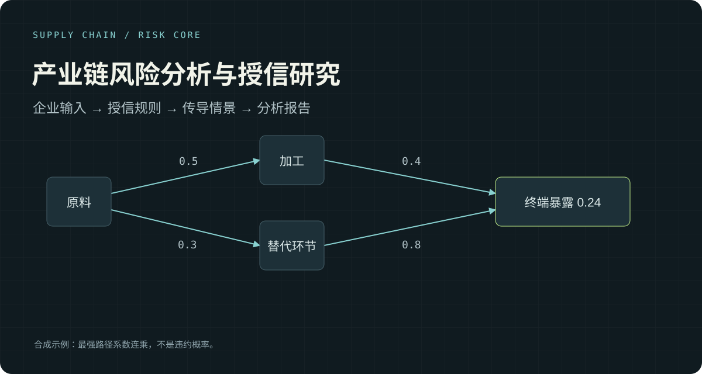

# 产业链风险传播与数据契约

工行杯个人参赛项目中，能够独立运行的路径传播、财务口径和提交契约核心。

调用方提供产业链图与财务输入，模块返回带出处的路径暴露和经过口径校验的指标；契约模块负责检查提交结构与来源材料。

| 模块 | 行为 | 关键边界 |
| --- | --- | --- |
| [supply_chain.py](src/supply_chain.py) | 沿有向图枚举简单路径、计算边权连乘、保留出处和估计标记 | 最强路径暴露不是违约概率，也不是 Leontief 总效应 |
| [financial_metrics.py](src/financial_metrics.py) | 校验 EBIT 组成项、利息保障倍数与流动性披露口径 | 缺失不等于零；新调用应显式关闭历史兼容 |
| [submission_contract.py](src/submission_contract.py) | 严格解析版本化契约，约束字段、路径、日期与来源哈希 | 重复 JSON 字段、来源不一致和未确认契约显式失败 |
| [missing_values.py](src/missing_values.py) | 统一缺失文本标记 | 只归一化缺失表达，不将其解释为无风险 |

## 快速运行

Python 3.10 或更新版本，运行依赖只有 NetworkX。以下命令均从仓库根目录执行。

```sh
python -m venv .venv
```

Windows：

```powershell
.\.venv\Scripts\python.exe -m pip install -r requirements.txt
.\.venv\Scripts\python.exe demo.py
.\.venv\Scripts\python.exe -m unittest discover -s tests -v
```

macOS / Linux：

```sh
.venv/bin/python -m pip install -r requirements.txt
.venv/bin/python demo.py
.venv/bin/python -m unittest discover -s tests -v
```

## 示例说明

`demo.py` 使用明确标注的合成图和合成金额，通过本仓库计算函数输出结果：

```text
原料 ──0.5──→ 加工 ──0.4──→ 终端
  └──0.3──→ 替代环节 ──0.8──┘

终端的最强路径暴露 = max(0.5 × 0.4, 0.3 × 0.8) = 0.24
EBIT = 利润总额 1.2 + 利息费用 0.3 = 1.5 亿元
利息保障倍数 = 1.5 / 0.3 = 5
```

这里的 0.24 不是预测概率。示例没有使用真实企业，没有运行完整信贷评分，也不产生比赛提交件。

程序实际输出 JSON：`downstream_exposure` 中“终端”为 `0.24`，`earnings.ebit_yi` 为 `1.5`，`earnings.interest_cover_x` 为 `5.0`。`data_kind` 明确标记为 `synthetic_demonstration`。

## 模块阅读顺序

1. 从 [demo.py](demo.py) 开始：构造输入图 → 调用 `downstream_of` → 校验 EBIT 组成项 → 输出 JSON。它只使用路径和财务模块。
2. 查看 [传播模块](src/supply_chain.py)：`upstream_of` 与 `downstream_of` 返回各节点的最强路径暴露；`transmission_paths` 返回带边出处、估计标记与强度的路径报告。前两者默认两跳，路径报告默认三跳。
3. 查看 [财务模块](src/financial_metrics.py)：先用 `canonicalize_earnings` 核验金额组成和口径，再读取标准化后的指标。示例金额统一为亿元。
4. 查看 [契约模块](src/submission_contract.py) 与 [ContractTests](tests/test_core.py)：`load_submission_contract` 面向满足版本化 schema 的文件及来源材料。仓库没有附带可用于赛事提交的真实契约；随意构造或不完整的输入应当报错。

测试与示例从 `src/` 导入模块。当前仓库没有提供可通过 `pip install` 安装的发行包；复用时需要明确设置模块路径或先补充包配置。

## 从比赛工程中保留的取舍

- **系数与数据解耦**：路径函数接收调用方给出的图，不在算法内加载固化行业表或猜测节点别名。
- **聚合节点只作端点**：调用方可通过 `endpoint_only` 禁止跨越聚合代理，以免把两个子行业通过总量节点连成虚构链路。
- **出处跟随路径**：每条边的 `provenance`、`estimated` 随报告返回；没有给出年份时保留 `None`。
- **财务口径先于比值**：EBIT 使用利润总额加利息费用；净财务费用与利息费用不混用。
- **未知不写成零**：无图覆盖不代表无风险；零利息费用下的保障倍数无定义。
- **信用链不能凭行业共现编造**：企业事实关系消费尚未实现，传入事实边会明确抛出 `NotImplementedError`。

## 测试与范围

测试覆盖最强路径与路径和的区别、环路、跳数边界、聚合节点、来源标记、财务组成项冲突、缺失和非有限数，以及重复或不完整契约。

这份公开核心不等同于完整参赛系统。行业数据接入、全量风险特征、信贷策略、比赛数据与历史交付物没有包含在内。当前测试不能证明预测准确率、实际信贷收益或比赛排名。

传播路径只接受 `[0, 1]` 的有限边权。节点暴露查询默认两跳，路径报告默认三跳；接口上限为 `MAX_HOPS = 8`，用于控制路径枚举规模。需要更大范围时应先评估图规模并修改该命名常量。聚合节点集合为空时不启用端点阻断规则。

财务模块保留原项目的历史兼容能力，`canonicalize_earnings` 与 `liquidity_metrics` 的 `allow_legacy` 默认均为 `True`。新的调用应像 `demo.py` 一样显式传入 `allow_legacy=False, allow_missing=False`。流动性模块的历史年度口径回退由 `SUBSEQUENT_INCOMPLETE_FALLS_BACK_TO_ANNUAL` 控制，并在结果中标记依据，不能混同为后续时点的完整披露。

## 来源与许可

这是个人参赛项目的公开整理版本。财务、契约和缺失值模块保留来源快照；传播模块为解除行业数据耦合进行了适配，详见 [来源说明](docs/provenance.md)。

代码采用 [MIT License](LICENSE)。本仓库不包含公司代码、赛事原始数据、企业原件、第三方数据表、截图或付费材料。NetworkX 使用其自身许可证；本仓库通过依赖安装引用它，没有复制其实现。
