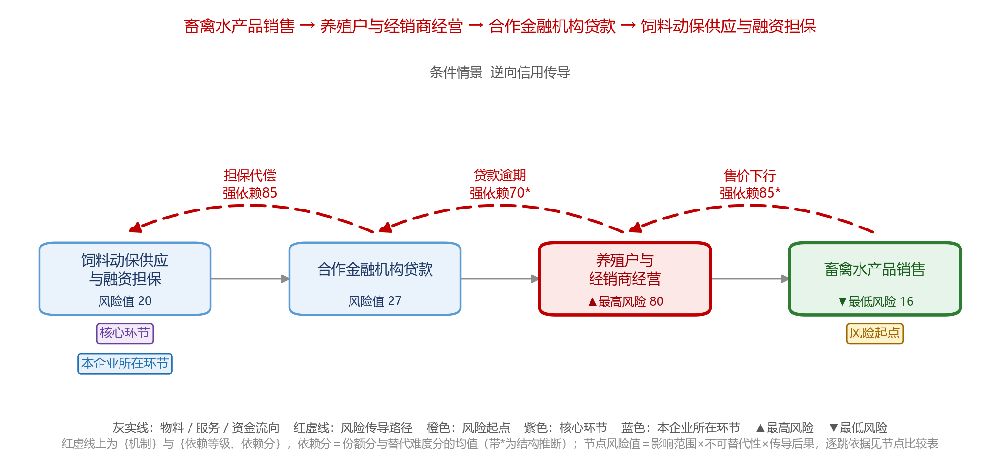
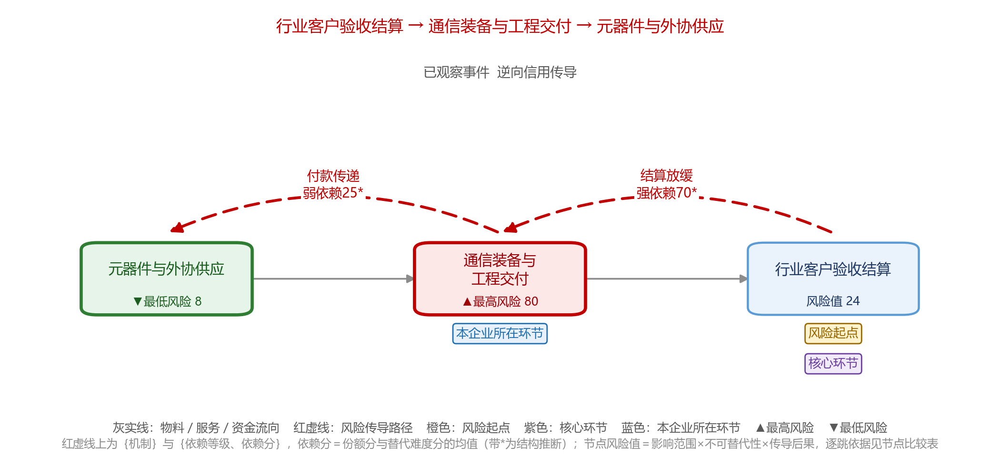

# 决赛阶段二分析成品

本目录保存本人编制的 2026-10-11 最终复核版：五家企业、13 条产业链、31 个工作表和 13 张图，以及代码与模型讲解材料。文件与保留的参赛成品逐字节一致，校验值见 [source-manifest.json](source-manifest.json)。

| 企业 | 工作簿 | 产业链图 |
| --- | --- | --- |
| 006 广州白云电器设备股份有限公司 | [Excel](006.xlsx) | [链 1](figures/006_chain1.png)、[链 2](figures/006_chain2.png)、[链 3](figures/006_chain3.png) |
| 011 广州视源电子科技股份有限公司 | [Excel](011.xlsx) | [链 1](figures/011_chain1.png)、[链 2](figures/011_chain2.png) |
| 018 广州视声智能股份有限公司 | [Excel](018.xlsx) | [链 1](figures/018_chain1.png)、[链 2](figures/018_chain2.png) |
| 023 广东海大集团股份有限公司 | [Excel](023.xlsx) | [链 1](figures/023_chain1.png)、[链 2](figures/023_chain2.png)、[链 3](figures/023_chain3.png) |
| 025 广州海格通信集团股份有限公司 | [Excel](025.xlsx) | [链 1](figures/025_chain1.png)、[链 2](figures/025_chain2.png)、[链 3](figures/025_chain3.png) |

[代码与模型讲解 Word](model-explanation.docx) 说明证据范围、业务判断、定量情景及其限制。各工作簿保留来源引用。

这些成品是当时的研究分析快照，不能当作对上述企业当前状况的判断。图中结构推断、说明性冲击参数和未知项应按原文口径解读；不存在由图中风险分直接得到违约概率的转换。

需要修改输入并重新生成通用示例时，使用仓库根目录的 `risk-study` 流程。完整历史成品的逐户复现另需相应的合法原始输入；本目录不包含赛事数据表、企业年报原件或授权评审数据包。

## 代表性图示

